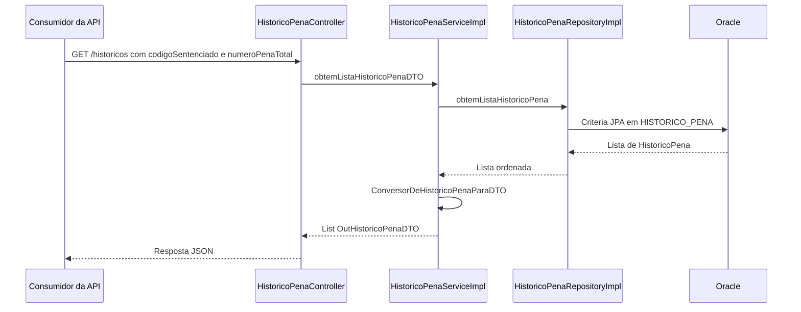
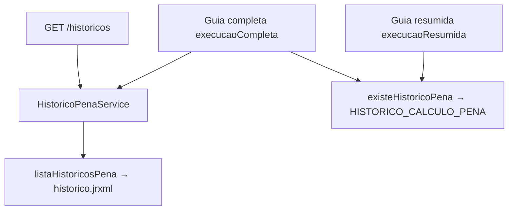

# 🔌 API de histórico da pena — INV-12

> [← Catálogo de fluxos](CATALOGO_FLUXOS.md#recursos-sem-tela-propria) | [Visão geral](../README.md) | [Recursos REST](../arquitetura/ARQUITETURA_AS_IS.md#recursos-rest)

O domínio de histórico da pena expõe o recurso REST somente leitura `GET /historicos` e é reutilizado **internamente** na composição da guia de execução penal completa. Nos fontes Angular examinados **não há tela nem serviço HTTP** que chame `/historicos`. O único consumidor efetivo localizado no backend é o `RelatorioController` (guia completa), que obtém entidades via `HistoricoPenaService` — **sem** passar pelo endpoint REST.

Esta especificação cobre o contrato da API, filtros e ordenação JPA, composição do DTO, o uso na guia completa e a distinção frente à verificação de existência usada na guia resumida (outra tabela).

Cobertura: **parcialmente mapeada**. Semântica de negócio dos tipos de histórico e o conteúdo exato renderizado pelo `historico.jrxml` permanecem PENDENTES de aprofundamento.

## 🗺️ Visão geral

| Recurso / uso | Método / caminho | Consumidor localizado |
| --- | --- | --- |
| Lista de históricos da pena | `GET /historicos` | Nenhum no frontend Angular. |
| Mesma lista (entidades) na guia completa | Chamada interna `HistoricoPenaService.obtemListaHistoricoPena` em `RelatorioController.execucaoCompleta` | Guia PDF completa (`historico.jrxml`). |
| Flag de existência de cálculo | `RelatorioService.existeHistoricoPena` (SQL em `HISTORICO_CALCULO_PENA`) | Guia completa e resumida (previsão de benefício / demonstrativo) — **não** é o mesmo recurso que `/historicos`. |

## 🧭 Fluxo de `GET /historicos`

## 🔌 Contrato REST

`IHistoricoPenaController` / `HistoricoPenaController` em `@Path("/historicos")`, produz e consome `application/json`.

| Parâmetro | Tipo | Obrigatório | Uso |
| --- | --- | :---: | --- |
| `codigoSentenciado` | `Long` | Sim (`@NotNull`) | Igualdade ao `id` do `Sentenciado` associado. |
| `numeroPenaTotal` | `Long` | Sim (`@NotNull`) | Igualdade a `NUM_PENA_TOTAL`. |

Não há paginação, ordenação configurável por query param nem filtro adicional no contrato. A resposta é `List<OutHistoricoPenaDTO>`. Lista vazia **não** lança exceção de negócio no serviço — devolve a lista convertida (possivelmente vazia).

### Campos de `OutHistoricoPenaDTO`

| Campo DTO | Origem principal |
| --- | --- |
| `historico` | Texto composto por `ConversorDeHistoricoPenaParaHistorico` (início, fim, quantidades, prazo, horas, fração, base benefício, nova situação). |
| `observacao` | `OBSERVACAO` |
| `dtHistorico` | `DT_HISTORICO` |
| `dtCriacaoHistorico` | `DT_CRIACAO_HISTORICO` |
| `nome` | `TipoHistoricoPena.nome` |
| `numHistorico` | `NUM_HISTORICO` |
| `numeroHistoricoFormatado` | `"( Nº: " + numHistorico + " )"` |
| `observacaoSistema` | `OBSERVACAO_SISTEMA` |
| `codHistorico` | `TipoHistoricoPena.id` (`COD_HISTORICO`) |

## 🗄️ Seleção, situação e ordenação

Entidade `HistoricoPena` → `THEMIS1G.HISTORICO_PENA`, com joins a `TipoHistoricoPena` (`TIPO_HISTORICO_PENA`), `TipoSituacaoPena` e `Sentenciado`. Persistência: `wsvecconsultas-persistence-unit`.

Predicado (`HistoricoPenaQueries.retornaListaHistoricoPena`), todas as condições em `AND`:

1. `sentenciado.id` = `codigoSentenciado`;
2. `numeroPenaTotal` = parâmetro;
3. `tipoHistoricoPena.imprimeExpediente` = `SimNao.S` (`"S"`) — apenas tipos com `IND_IMPRIME_EXPEDIENTE = S`;
4. `situacaoRegistro` = `SituacaoRegistro.A`.

Ordenação no repositório (`HistoricoPenaRepositoryImpl`):

1. `dataHistorico` **ASC**;
2. `dataCriacaoHistorico` **ASC**.

Não há filtro sobre `situacaoRegistro` do tipo de histórico na query; apenas o indicador de imprime expediente e a situação do registro do histórico.

## 📜 Composição do texto `historico`

`ConversorDeHistoricoPenaParaHistorico` concatena trechos quando os campos existem (ordem fixa):

| Trecho | Condição |
| --- | --- |
| ` Início: {data}` | `dataInicio` não nula |
| ` Fim: {data}` | `dataFim` não nula |
| ` {n} ano(s)` | `quantidadeAnos` não nula |
| `, {n} mes(es)` | `quantidadeMeses` não nula |
| `, {n} dia(s)` | `quantidadeDias` não nula |
| ` Prazo apresentação: {n} meses` | `prazoApresentacao` não nulo |
| ` {n} horas` | `quantidadeHoras` > 0 |
| `{fracao1}/{fracao2}` | `fracao1` não nula |
| ` Base Benefício: {data}` | `dataBaseBeneficio` não nula |
| ` Nova Situação: {nome}` | `codSituacao` não nulo (nome via `TipoSituacaoPena`) |

A interpretação jurídica completa de cada tipo (`TipoHistoricoPena.nome`) permanece PENDENTE.

## 🗺️ Relação com as guias (sem presumir HTTP)

| Caminho | O que faz |
| --- | --- |
| Guia **completa** | Chama `historicoService.obtemListaHistoricoPena` (mesmo predicado/ordenação do repositório), converte com `ConversorDeHistoricoPenaParaRelatorioDTO` (reordena só por `dataHistorico` ASC) e alimenta o sub-relatório `historico.jrxml`. Também usa `existeHistoricoPena` em previsão de benefício / demonstrativo. |
| Guia **resumida** | **Não** monta a lista de `HISTORICO_PENA` para o PDF. Usa `existeHistoricoPena` e demais consultas de `RelatorioService` no bloco comum/resumido. |
| `existeHistoricoPena` | SQL nativo em `THEMIS1G.HISTORICO_CALCULO_PENA` (último cálculo com `situacao_calculo in (3, 4)` e registro ativo). Retorna `true` se houver resultado; `false` em `NoResultException`. **Não** é equivalente a “há linhas em `/historicos`”. |

Não se deve afirmar que a guia completa consome `GET /historicos` pela rede: o acoplamento é por injeção do serviço EJB no controlador de relatórios.

## ⚠️ Lacunas e limites

| Tema | Situação |
| --- | --- |
| Consumidor Angular de `/historicos` | Não localizado. |
| Exceção de lista vazia no REST | Não lançada; lista vazia possível. |
| Catálogo de códigos/tipos de histórico | PENDENTE (apenas `nome` e flag `IND_IMPRIME_EXPEDIENTE`). |
| Layout Jasper `historico.jrxml` | Arquivo presente; mapeamento visual fino PENDENTE. |
| Equivalência `existeHistoricoPena` vs lista REST | Tabelas distintas (`HISTORICO_CALCULO_PENA` vs `HISTORICO_PENA`). |
| Envelope HTTP corporativo | Fora do pacote analisado. |

## 📆 Cenários de verificação sugeridos

| Cenário | Condição | Comportamento esperado |
| --- | --- | --- |
| HIST-01 | `GET /historicos` com PEC/pena e registros ativos com `IND_IMPRIME_EXPEDIENTE = S` | Lista de DTOs ordenada por data do histórico e data de criação. |
| HIST-02 | Mesmos identificadores sem registros elegíveis | Lista vazia (sem exceção de negócio no serviço). |
| HIST-03 | Tipos com `IND_IMPRIME_EXPEDIENTE` diferente de `S` | Fora do predicado; não entram na lista. |
| HIST-04 | Geração da guia completa | Parâmetro/coleção de históricos preenchida via serviço interno; não exige chamada HTTP a `/historicos`. |
| HIST-05 | Guia resumida | Sem lista de `HISTORICO_PENA`; flag via `HISTORICO_CALCULO_PENA`. |

## 🔗 Referências de implementação

| Camada | Arquivos |
| --- | --- |
| Contrato / controlador | `IHistoricoPenaController.java`, `HistoricoPenaController.java` |
| Serviço / repositório / query | `HistoricoPenaService.java`, `HistoricoPenaServiceImpl.java`, `HistoricoPenaRepository.java`, `HistoricoPenaRepositoryImpl.java`, `HistoricoPenaQueries.java` |
| Entidades | `HistoricoPena.java`, `TipoHistoricoPena.java`, `TipoSituacaoPena.java` |
| DTOs e conversores API | `OutHistoricoPenaDTO.java`, `ConversorDeHistoricoPenaParaDTO.java`, `ConversorDeHistoricoPenaParaHistorico.java` |
| Guia / relatório | `RelatorioController.java` (`listaHistoricosPena`, `existeHistoricoPena`), `ConversorDeHistoricoPenaParaRelatorioDTO.java`, `OutHistoricoRelatorioDTO.java`, `RelatorioQueries.EXISTE_HISTORICO_PENA`, `historico.jrxml` |

Relação no inventário: [Catálogo — recursos sem tela própria](CATALOGO_FLUXOS.md#recursos-sem-tela-propria) · [Componentes por fluxo](CATALOGO_FLUXOS.md#componentes-e-classes-por-fluxo)

> [← Catálogo de fluxos](CATALOGO_FLUXOS.md#recursos-sem-tela-propria) | [Visão geral](../README.md) | [Arquitetura →](../arquitetura/ARQUITETURA_AS_IS.md)
