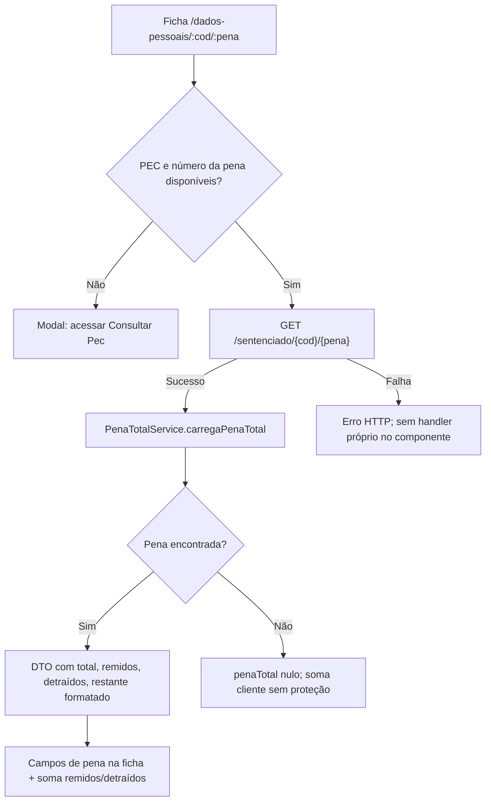

# 📜 Resumo da pena e cálculos exibidos — UC-PENA-01

> [← Catálogo de fluxos](CATALOGO_FLUXOS.md) | [Visão geral](../README.md) | [Rotinas Oracle](../arquitetura/ARQUITETURA_AS_IS.md#rotinas-oracle)

Este fluxo corresponde à parte de **pena total** de **INV-03** (junto com [dados pessoais](FLUXO_DADOS_PESSOAIS.md), quando preenchido). Consolida o AS-IS do **resumo da pena** carregado com a ficha do sentenciado, separando: (1) dados persistidos/consultados, (2) cálculos no cliente Angular e (3) dependências SQL/PL/SQL. Não valida fundamento jurídico nem resultados Oracle em execução.

Cobertura: analisada parcialmente. Semântica das rotinas Oracle e equivalência dos cálculos permanecem **PENDENTES**.

## 📜 História e condições de uso

Como usuário da ficha do sentenciado, quero ver o resumo consolidado da pena total selecionada — inclusive total formatado e dias remidos/detraídos — para conhecer a situação executória apresentada pelo portal.

| Item | Detalhamento |
| --- | --- |
| Ator | Usuário que abriu a ficha a partir da consulta de PEC (`dados-pessoais/:codSentenciado/:numPenaTotal`). |
| Objetivo | Exibir o bloco de pena total associado ao código do sentenciado e ao número da pena. |
| Gatilho | Carregamento de `DadosPessoaisComponent` com PEC e número de pena preenchidos. |
| Pré-condições | `GET /sentenciado/{codigoSentenciado}/{numeroPenaTotal}` disponível; registro de pena com `situacao_registro = 'A'`. |
| Entradas | `codigoSentenciado`, `numeroPenaTotal` (rota e chamada HTTP). |
| Resultado de sucesso | Objeto `penaTotal` no DTO do sentenciado; tela exibe campos do resumo e a soma cliente de remidos/detraídos. |
| Resultado sem pena | `PenaTotalServiceImpl.obtemPenaTotal` retorna `null` quando o repositório não encontra registro. |
| Regras relacionadas | RN-03 (ano comercial 360/30); RN-PENA-001 a RN-PENA-004. |

## 🗺️ Fluxo principal

1. O cliente chama `SentenciadoService.getDadosPessoais(numPec, numPena)` → `GET …/sentenciado/{numPec}/{numPena}`.
2. No backend, o serviço de sentenciado monta o DTO cadastral e aciona `PenaTotalService.carregaPenaTotal(...)`.
3. `PenaTotalServiceImpl.obtemPenaTotal` consulta `PenaTotalRepository.obtemPenaTotal` (SQL nativo sobre `pena_total`, `judicancia_pena`, `casa_detencao`).
4. Se a entidade for nula, o serviço devolve `null` e encerra o complemento de pena.
5. Caso contrário, `ConversorDePenaTotalParaDTO` monta `OutPenaTotalDTO` (totais, datas, remidos, detraídos, `totalPena` textual, `restanteSemProvisorioFormatado` via conversor Java).
6. Em seguida, `procedureVecPenaPrincipal` executa `SELECT THEMIS1G.VEC_PENA_PRINCIPAL(?, ?) FROM DUAL` e preenche o nome/descrição da pena no DTO (`dto.setNome(...)`).
7. Na tela, campos de casa de detenção, juizado, situação, localização dos autos, datas, total da pena e horas de PSC são ligados a `dadosPessoais.data.penaTotal.*`.
8. O campo “Dias Remidos/Detraídos” chama `getQtdeDiasRemidosDetraidosCalc()`, que soma no cliente `qtdeDiasRemidos + qtdeDiasDetraidos` após normalizar nulos para zero.

## 🗺️ Navegação do resumo da pena

O resumo não possui rota própria: acompanha a [ficha de dados pessoais](FLUXO_DADOS_PESSOAIS.md#navegacao-da-ficha). O diagrama abaixo isola o trecho da pena na mesma resposta HTTP.

## 🗄️ Distinção: total, restante e remidos/detraídos

| Conceito | Origem principal | Aparece na ficha? | Observação AS-IS |
| --- | --- | --- | --- |
| **Total da pena** (`totalPena`) | SQL (`DECODE`/`NVL` sobre anos, meses e dias) e, no DTO, também `ConversorDePenaTotalParaDTO.getTotalPena` a partir dos totais numéricos | Sim, se `totalPena != ''` | Se a soma anos+meses+dias for zero, o texto fica vazio e o rótulo/campo não são renderizados (`*ngIf`). |
| **Dias remidos / detraídos** | Colunas `qtde_dias_remidos` e `qtde_dias_detraidos` no SQL; soma **somente no cliente** | Sim (um único campo com a soma) | Valores nulos viram `0` antes da soma; o backend não realiza essa soma no conversor. |
| **Pena restante sem provisório** | SQL monta `restante_s_provisorio` com `VEC_RETORNA_DIAS_COMERCIAL` e 360/30; o DTO expõe `restanteSemProvisorioFormatado` calculado em **Java** (`ConversorDePenaTotalParaRestanteSemProvisorioFormatado`) | Não localizado no template da ficha | O valor viaja no modelo (`penaTotal.ts`), mas não há binding HTML correspondente. |
| **Pena restante / previsão com provisório** | SQL (`VEC_SOMA_DATA_COM_PRAZO`, `VEC_DESCRICAO_ANO_MES_DIA`, `THEMIS1G.VEC_RETORNA_DIAS_COMERCIAL`) | Não localizado no template | Presente na consulta nativa; mapeamento para o DTO de tela da ficha não inclui esses campos no conversor examinado. |
| **Total de horas de PSC** | `pt.total_horas_pena` | Sim | Exibido como “Total de Horas de PSC”. |

## 🛠️ Cálculos do cliente

### 🛠️ Soma de remidos e detraídos (RN-PENA-001)

Em `DadosPessoaisComponent.getQtdeDiasRemidosDetraidosCalc()`:

1. Se `qtdeDiasDetraidos == null`, atribui `0` ao próprio objeto.
2. Se `qtdeDiasRemidos == null`, atribui `0`.
3. Retorna a soma aritmética dos dois campos.

Não há tratamento explícito de valores negativos nesse método. Se `penaTotal` for nulo, a expressão `this.dadosPessoais.data.penaTotal....` pode falhar na avaliação do template — o método **não** protege a ausência do objeto de pena.

### 🧭 Formatação de CPF

Independente do resumo de pena, o mesmo componente formata o CPF para exibição após o retorno HTTP. Isso não altera dígitos nem faz parte dos cálculos de prazo.

## 🔌 Dependências SQL / PL/SQL e conversores

### 🔌 Consulta nativa `obtemPenaTotal`

Filtro: `pt.situacao_registro = 'A'`, `cod_sentenciado = ?`, `num_pena_total = ?`, com `LEFT JOIN` em `judicancia_pena` (término nulo, registro ativo) e `casa_detencao`.

Funções e expressões identificadas:

| Função / expressão | Papel no SQL |
| --- | --- |
| `vec_pena_principal(cod, num)` | Nome/descrição da pena no `SELECT` principal. |
| `THEMIS1G.VEC_PENA_PRINCIPAL(?, ?)` | Chamada adicional após a conversão (`procedureVecPenaPrincipal`). |
| `DECODE` + `NVL` sobre totais | `total_pena`, `total_provisorio` / trechos de provisório: zero → texto vazio ou `NULL`. |
| `VEC_RETORNA_DIAS_COMERCIAL` | Base do restante sem provisório (e trechos de cumprimento/benefício). |
| `THEMIS1G.VEC_RETORNA_DIAS_COMERCIAL` | Restante com provisório. |
| `VEC_SOMA_DATA_COM_PRAZO` | Soma o prazo provisório à data fim. |
| `VEC_DESCRICAO_ANO_MES_DIA` | Descrições textuais de prazos (previsão com provisório, prazo de data-base). |
| Aritmética `× 360` / `× 30` | Conversão comercial embutida em expressões SQL (RN-03 / RN-PENA-004). |

O corpo PL/SQL dessas rotinas **não** está no pacote de fontes Java; a semântica interna permanece PENDENTE.

### 🛠️ Conversor Java do restante sem provisório (RN-PENA-002)

`ConversorDePenaTotalParaRestanteSemProvisorioFormatado`:

- usa data atual (`LocalDate.now()`) e `dataFimCumprimento` (ou “hoje” se a data fim for nula);
- converte cada data em `ano × 360 + mês × 30 + dia`;
- subtrai início − fim na ordem **fim − início** (dias comerciais “aproximados”);
- decompõe o resultado com `/ 360`, `% 360 / 30` e `% 30`;
- formata `"X ano(s), Y mes(es), Z dia(s)"`.

Esse cálculo **não** chama `VEC_RETORNA_DIAS_COMERCIAL`. Opera em paralelo ao texto `restante_s_provisorio` do SQL. Não há, no conversor, ramificação específica para resultado negativo ou para zero além da formatação numérica direta.

### 📜 Total textual no DTO (RN-PENA-003)

`getTotalPena` / `obtemTotalPorExtenso`: se `anos + meses + dias == 0`, retorna string vazia; caso contrário, `"X ano(s), Y mes(es) e Z dia(s)"`, com nulos de componente tratados como `0` na montagem dos totais.

Campos de provisório no conversor usam `0L` quando nulos (`totalAnosProvisorio`, `totalMesesProvisorio`, `totalDiasProvisorio`). Remidos e detraídos são repassados sem substituição por zero no backend.

## 🗺️ Campos exibidos na ficha (pena)

| Rótulo na tela | Binding |
| --- | --- |
| Casa de Detenção | `penaTotal.nomeCasaDetencao` |
| Juizado Atual | `penaTotal.numJuizado` |
| Situação Atual | `penaTotal.situacaoPena` |
| Localização dos Autos | `penaTotal.localizacaoAutos` |
| Data Início | `penaTotal.dtInicioCumprimento.txt` |
| Data Fim | `penaTotal.dtFimCumprimento.txt` |
| Total da Pena | `penaTotal.totalPena` (somente se não vazio) |
| Total de Horas de PSC | `penaTotal.totalHorasPena` |
| Dias Remidos/Detraídos | `getQtdeDiasRemidosDetraidosCalc()` |

## 📜 Regras resumidas

| ID | Comportamento |
| --- | --- |
| RN-03 | Expressões de prazo usam ano comercial de 360 dias e mês de 30 dias (SQL e conversor Java). Fundamento normativo PENDENTE. |
| RN-PENA-001 | Antes de somar remidos e detraídos, o cliente substitui nulos por zero. |
| RN-PENA-002 | O restante sem provisório formatado no DTO é calculado em Java com 360/30 a partir de “hoje” e data fim, separado do texto SQL `restante_s_provisorio`. |
| RN-PENA-003 | Soma anos+meses+dias igual a zero → descrição textual do total vazia. |
| RN-PENA-004 | A consulta e a procedure auxiliar acionam `vec_pena_principal` / `VEC_PENA_PRINCIPAL`, `VEC_RETORNA_DIAS_COMERCIAL`, `VEC_SOMA_DATA_COM_PRAZO` e `VEC_DESCRICAO_ANO_MES_DIA`. |

## 📆 Cenários de verificação (propostos)

Não foi localizada, nos insumos disponíveis deste workspace, uma tabela previamente numerada `PENA-01`…`PENA-06`. Os seis cenários abaixo são **PROPOSTOS** a partir dos comportamentos comprovados nos fontes (checklist do card: 360/30, nulos, zeros, queries/conversores). Não representam testes executados nem aceite institucional.

| ID | Condição e ação | Resultado a verificar |
| --- | --- | --- |
| PENA-01 | Remidos e detraídos nulos na resposta | Soma exibida = `0`; campos no objeto passam a `0` após a chamada do método. |
| PENA-02 | Remidos = R e detraídos = D (não nulos) | Soma exibida = `R + D`. |
| PENA-03 | `totalAnosPena + totalMesesPena + totalDiasPena = 0` | `totalPena` vazio; bloco “Total da Pena” oculto na ficha. |
| PENA-04 | Totais numéricos > 0 | `totalPena` no formato `X ano(s), Y mes(es) e Z dia(s)`. |
| PENA-05 | Data fim de cumprimento conhecida; inspecionar `restanteSemProvisorioFormatado` no DTO | String gerada pelo conversor Java com decomposição 360/30; **sem** exigir igualdade com o texto SQL nem exibição na ficha. |
| PENA-06 | Repositório sem linha de pena para o par código/número | `obtemPenaTotal` → `null`; ausência de proteção no método de soma do cliente ao acessar `penaTotal`. |

Limites 29/30 e 359/360 citados em orientações de regressão da Onda 1 dependem da semântica de `VEC_RETORNA_DIAS_COMERCIAL` (PENDENTE) e não foram reproduzidos como oráculos neste documento.

## ⚠️ Lacunas e limites

| Tema | Situação |
| --- | --- |
| Corpo PL/SQL das funções Themis1G | Ausente nos fontes Java; resultados e casos de borda Oracle não validados. |
| Equivalência SQL × Java do restante sem provisório | Dois caminhos distintos; equivalência não comprovada. |
| Exibição do restante na ficha | Campo no modelo; binding HTML não localizado. |
| Fundamento normativo do ano comercial 360/30 | PENDENTE (RN-03). |
| `getCasaDetencao().getNome()` no conversor | Acesso direto; comportamento com casa nula não caracterizado aqui. |
| Entrega parcial 4–6/11/2026 | Não localizada neste workspace; eventual conjunto oficial de cenários PENA permanece a confirmar. |

## 🔗 Referências de implementação

| Camada | Arquivos |
| --- | --- |
| Tela e soma cliente | `dados-pessoais/dados-pessoais.component.ts`, `dados-pessoais.component.html`, `penaTotal.ts` |
| Chamada HTTP | `services/sentenciado.service.ts` |
| Serviço de pena | `PenaTotalServiceImpl.java` |
| Repositório e SQL | `PenaTotalRepositoryImpl.java`, `PenaTotalQueries.java` |
| Conversores | `ConversorDePenaTotalParaDTO.java`, `ConversorDePenaTotalParaRestanteSemProvisorioFormatado.java` |
| DTO | `OutPenaTotalDTO.java` |

Relação no inventário: [Catálogo — UC-PENA-01](CATALOGO_FLUXOS.md#uc-pena-01) · [Componentes por fluxo](CATALOGO_FLUXOS.md#componentes-e-classes-por-fluxo) · [Arquitetura — rotinas Oracle](../arquitetura/ARQUITETURA_AS_IS.md#rotinas-oracle)

> [← Catálogo de fluxos](CATALOGO_FLUXOS.md) | [Visão geral](../README.md) | [Rotinas Oracle](../arquitetura/ARQUITETURA_AS_IS.md#rotinas-oracle)
