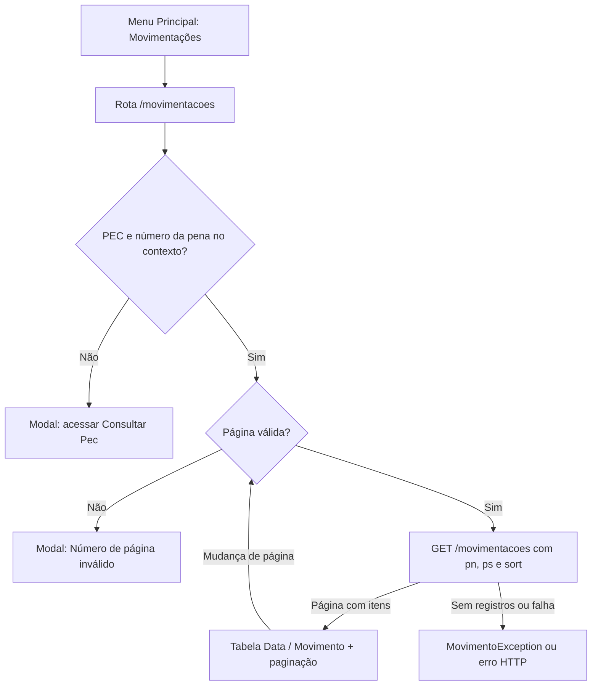

# 📋 Consulta de movimentações — UC-MOV-01

> [← Catálogo de fluxos](CATALOGO_FLUXOS.md#registros-da-execucao) | [Visão geral](../README.md) | [Recursos REST](../arquitetura/ARQUITETURA_AS_IS.md#recursos-rest)

A tela de movimentações lista, de forma **paginada**, os movimentos da pena do PEC selecionado que atendem aos filtros de situação e de especialização VEC. Corresponde a **INV-06**. Não se confunde com `GET /incidentes/movimentos`, que trata movimentos de incidente e não substitui esta consulta.

Cobertura: **parcialmente mapeada**. A divergência `sort` (cliente) versus `order` (controlador) está registrada; o efeito efetivo da ordenação em execução permanece PENDENTE de validação.

## 📜 História e condições de uso

Como usuário do Portal PEC, quero ver as movimentações do PEC/pena selecionados, página a página, para acompanhar a linha do tempo processual exibida na execução.

| Item | Detalhamento |
| --- | --- |
| Ator | Usuário que já selecionou PEC e número de pena (contexto `PecService`). |
| Objetivo | Exibir tabela paginada com data formatada e nome do movimento (com complemento, quando houver). |
| Gatilho | Abertura da rota `/movimentacoes` (`MovimentacoesComponent.ngOnInit`) ou mudança de página na barra de paginação. |
| Pré-condições | `selectedPec.numeroPEC` e `selectedPec.numeroPena` preenchidos; senão, modal de orientação e **sem** chamada HTTP. |
| Entradas HTTP (cliente) | Query params `codigoSentenciado`, `numeroPenaTotal`, `pn`, `ps`, `sort`. |
| Entradas HTTP (contrato Java) | Query params `codigoSentenciado`, `numeroPenaTotal`, `pn`, `ps`, `order` (lista). |
| Resultado de sucesso | Página `Page<MovimentoPena>` envelopada; tabela com colunas Data da Movimentação e Movimento; rodapé de paginação. |
| Resultado sem registros | Backend lança `MovimentoException` com mensagem de ausência; ver [vazios e erros](#vazios-e-erros). |
| Chamada | `GET …/movimentacoes?codigoSentenciado=…&numeroPenaTotal=…&pn=…&ps=…&sort=…` |

## 🗺️ Entrada e navegação

A consulta responde pela rota `/movimentacoes` (breadcrumb **Movimentações**), acessível pelo item **Movimentações** do menu principal.

1. Ao inicializar, o componente habilita a barra de pesquisa rápida de PEC no cabeçalho (`PecSearchService`).
2. Lê o par `numeroPEC` e `numeroPena` do contexto compartilhado (`PecService`).
3. Se qualquer identificador estiver vazio, exibe o modal `"Por favor acesse a tela de Consultar Pec para requisitar suas informações."` e não dispara HTTP.
4. Com ambos preenchidos, chama `performSearchByFilter` com a página corrente (início em `1`).
5. A paginação (Primeiro / Anterior / Ir / Próximo / Último) reexecuta a mesma busca com outro `pn`, validando o número da página no cliente.

<a id="navegacao-das-movimentacoes"></a>

### 🗺️ Fluxo de navegação na tela



## 🧭 Da requisição à exibição

```mermaid
sequenceDiagram
    participant Tela as Tela de Movimentações
    participant HTTP as MovimentacaoService Angular
    participant REST as MovimentoController
    participant EJB as MovimentoServiceImp
    participant REP as MovimentoPenaRepositoryImpl
    participant DB as Oracle
    Tela->>HTTP: PEC, pena, pn, ps, orderBy local
    HTTP->>REST: GET /movimentacoes?...&pn&ps&sort
    Note over HTTP,REST: Cliente envia sort; controlador lê order
    REST->>EJB: PageRequest (pn, ps, Sort)
    EJB->>REP: recuperarMovimento(cod, pena, pageRequest)
    REP->>DB: Criteria JPA em MOVIMENTO_PENA + especialização VEC
    DB-->>REP: Página de MovimentoPena
    REP-->>EJB: Page
    EJB-->>REST: Page formatada ou MovimentoException
    REST-->>HTTP: JSON envelopado
    HTTP-->>Tela: content + totalResults
```

## 🔌 Contrato e paginação

O recurso `GET /movimentacoes` (`@Path("/movimentacoes")`) produz e consome `application/json`. Os identificadores de PEC e pena são `@NotNull` no controlador.

| Parâmetro | Lado | Tipo / origem | Uso |
| --- | --- | --- | --- |
| `codigoSentenciado` | Cliente e REST | `Long`; `selectedPec.numeroPEC` | Filtro no predicado. |
| `numeroPenaTotal` | Cliente e REST | `Long`; `selectedPec.numeroPena` | Filtro no predicado. |
| `pn` | Cliente e REST | Página corrente; início em `1` | Índice da página no `PageRequest`. |
| `ps` | Cliente e REST | Tamanho da página; padrão cliente `Constants.DEFAULT_PAGE_SIZE` = **15** | Tamanho no `PageRequest`. |
| `sort` | **Somente cliente** | Valor fixo `selectedOrderBy = "dataMovimento"` | Enviado em `HttpParams`; **não** há `@QueryParam("sort")` no controlador. |
| `order` | **Somente REST** | `List<String> orderExpressions` | Monta `Sort`; se nulo ou vazio, o controlador usa `new Sort("dataMovimento")`. |

Resposta tipada no cliente: envelope `Movimentacoes` com `data` (`Page`: `content`, `totalResults`, `request`) e campos opcionais `exceptionKey`, `messages`, `uri`. Cada item de `content` expõe, entre outros, `dataMovimentoFormatada` e `nomeFormatado` usados na tabela.

### Divergência `sort` versus `order`

O Angular envia **`sort=dataMovimento`**. O `MovimentoController` declara apenas **`order`**. Na chamada padrão do Portal, `order` chega ausente e o backend aplica o *fallback* `new Sort("dataMovimento")`.

| Afirmação | Situação |
| --- | --- |
| Nomes dos parâmetros diferem (`sort` ≠ `order`) | Comprovado nos fontes. |
| Fallback do controlador para o campo `dataMovimento` quando `order` está vazio | Comprovado. |
| Direção ASC/DESC do `Sort` corporativo e se o valor enviado em `sort` chega a influenciar a query | **PENDENTE** (classe `br.jus.tjrs.arch.commons.sort.Sort` fora do pacote analisado; sem execução comparativa). |
| Compatibilidade se um cliente enviar `order` com expressão válida | Contrato Java aceita a lista; efeito concreto PENDENTE de validação. |

Não se deve assumir, só pela intenção do cliente, que a ordenação enviada em `sort` seja aplicada.

## 🗄️ Regras de seleção e persistência

A consulta usa JPA Criteria (`MovimentoPenaQueries.retornarMovimentacoes`) sobre `wsvecconsultas-persistence-unit`, entidade `MovimentoPena` (`THEMIS1G.MOVIMENTO_PENA`), com join ao `Movimento` e à `EspecializacaoMovimentoVec` (`THEMIS1G.ESPECIALIZACAO_MOVIMENTO_VEC`).

Predicado identificado (todas as condições em `AND`):

1. `movimentoPena.situacaoRegistro` = `SituacaoRegistro.A` (ativo);
2. `especializacaoMovimentoVec.situacaoRegistro` = `A`;
3. `especializacaoMovimentoVec.indicadorImprimeExpediente` = `true` (`IND_IMPRIME_EXPEDIENTE`);
4. `codigoSentenciado` igual ao parâmetro;
5. `numeroTotalPena` igual ao parâmetro.

A paginação é aplicada no repositório via `find(predicate, pageRequest)`. Não há filtro de período, tipo de movimento ou texto livre na tela.

### Formatação no serviço

`MovimentoServiceImp.formataDados` percorre o `content` da página:

| Campo derivado | Regra no fonte |
| --- | --- |
| `dataMovimentoFormatada` | `dataMovimento` formatada com padrão `dd/MM/yyyy`. |
| `nomeFormatado` | `movimento.nome`; se `complemento` não for em branco, concatena `" - "` + complemento. |

A chamada a `movimento.getNome()` ocorre antes da checagem `Optional` do movimento; se o relacionamento vier nulo, o comportamento em execução depende do runtime (risco de falha na formatação).

## 📜 Apresentação na tela

| Coluna / elemento | Binding / origem |
| --- | --- |
| **Data da Movimentação** | `movimentacao.dataMovimentoFormatada` |
| **Movimento** | `movimentacao.nomeFormatado` (largura ~55%) |
| Contador | `Exibindo {inicial} até {final} de {totalRows} registros` (`Pagination`) |
| Controles | Primeiro, Anterior, campo de página + Ir, Próximo, Último |

Não há coluna de ações, link de detalhe por linha, alteração de tamanho de página na UI nem seletor de ordenação (o `orderBy` local permanece fixo em `"dataMovimento"`).

Enquanto `movimentacoes == null`, o template mostra apenas `<div class="blank"></div>`. Com resposta carregada, a tabela itera `movimentacoes?.data?.content`.

<a id="vazios-e-erros"></a>

## ⚠️ Ausência de resultados e tratamento de erros

| Situação | Comportamento implementado |
| --- | --- |
| PEC ou número da pena ausentes | Modal `"Por favor acesse a tela de Consultar Pec para requisitar suas informações."`; sem HTTP. |
| Página inválida (`NaN`, ≤ 0 ou > `totalPages`) | Modal `"Número de página inválido."`; sem nova chamada. |
| Página sem conteúdo (`page` nulo, `content` nulo ou vazio) | `MovimentoServiceImp` lança `MovimentoException("Não foi encontrada nenhuma movimentação para o PEC informado.")`. |
| Antes da resposta (`movimentacoes == null`) | Apenas o `div.blank`. |
| Erro HTTP / exceção de negócio | `performSearchByFilter` não define callback de erro no `.subscribe(...)`; o alerta depende do interceptor HTTP global. |

## 🧭 Segurança e limites

- A rota `/movimentacoes` **não** declara `AuthGuard` no roteamento Angular; o controlador não aplica verificação própria de perfil.
- O envelope HTTP e o comportamento interno de `Page` / `Sort` da biblioteca corporativa estão fora do pacote `wsvecconsultas` analisado.
- Relatórios PDF e `GET /incidentes/movimentos` usam outros caminhos; não fazem parte deste fluxo de tela.

## 📆 Cenários de verificação sugeridos

| Cenário | Condição inicial | Comportamento esperado |
| --- | --- | --- |
| MOV-01 | Abrir `/movimentacoes` sem PEC ou pena no contexto | Modal de Consultar PEC; sem `GET /movimentacoes`. |
| MOV-02 | PEC e pena com movimentos que passam pelos filtros | `GET` com `pn=1`, `ps=15`, `sort=dataMovimento`; tabela e total de registros; ordenação efetiva a conferir (fallback `order` vazio). |
| MOV-03 | Mesmo contexto, avançar página ou digitar página inválida | Nova busca com `pn` alterado, ou modal de página inválida sem HTTP. |
| MOV-04 | Par PEC/pena sem movimentos elegíveis | `MovimentoException` com mensagem de ausência; tratamento via interceptor. |
| MOV-05 | Inspecionar query string | Confirmar presença de `sort` e ausência de `order` na chamada do Angular. |

## 🔗 Referências de implementação

| Camada | Arquivos |
| --- | --- |
| Rota e menu | `app-routing.module.ts`, `header/header.component.html` |
| Tela e modelos | `movimentacoes/movimentacoes.component.ts`, `movimentacoes.component.html`, `movimentacoes.ts`, `movimentacao.ts`, `page.ts` |
| Paginação cliente | `util/pagination.ts`, `util/constants.ts` (`DEFAULT_PAGE_SIZE`) |
| Serviço HTTP | `services/movimentacao.service.ts` (`recuperarMovimentacoes`) |
| Controlador REST | `MovimentoController.java` (`@Path("/movimentacoes")`) |
| Serviço / repositório / query | `MovimentoServiceImp.java`, `MovimentoPenaRepositoryImpl.java`, `MovimentoPenaQueries.java` |
| Entidades e exceção | `MovimentoPena.java`, `Movimento.java`, `EspecializacaoMovimentoVec.java`, `MovimentoException.java` |

Relação no inventário: [Catálogo — registros da execução](CATALOGO_FLUXOS.md#registros-da-execucao) · [Componentes por fluxo](CATALOGO_FLUXOS.md#componentes-e-classes-por-fluxo)

> [← Catálogo de fluxos](CATALOGO_FLUXOS.md#registros-da-execucao) | [Visão geral](../README.md) | [Arquitetura →](../arquitetura/ARQUITETURA_AS_IS.md)
